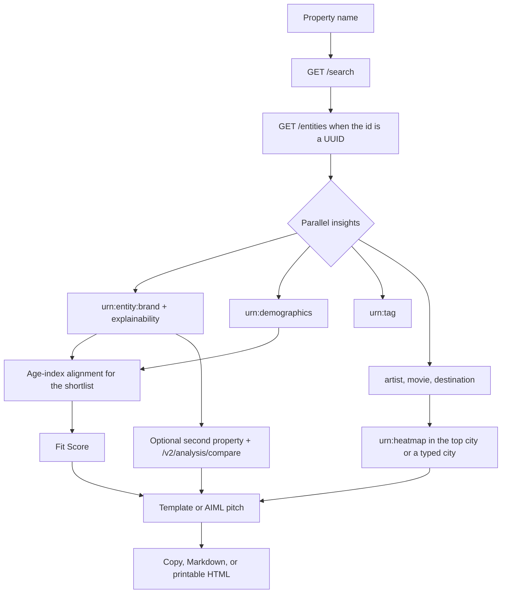

# SponsorFit

SponsorFit is a sponsorship desk for teams, agencies, creators, and event organizers. A buyer names a public property — a club, an artist, a festival, a podcast — and an agent asks [Qloo Taste AI](https://docs.qloo.com) which brands that audience actually over-indexes on. It ranks those brands with a visible Fit Score and writes a short pitch that can only cite signals Qloo returned.

This is not a consumer recommender and it is not a “cultural DNA” profile. The output is a sponsor shortlist with the evidence attached.

The repo is MIT licensed. It is a submission for the Qloo Agent Hackathon (Devpost deadline 30 October 2026, 11:45 PM EDT).

## The problem

Sponsorship decks still start from the logo on the jersey and a hunch about the audience. Category exclusivity, a rival’s existing deal, and “brands that feel premium” get argued without a taste signal. The room — the fans, listeners, or festival crowd — already concentrates on some brands and ignores others. SponsorFit makes that concentration the first page of the brief.

## How it uses Qloo

Every live call is a server-side GET against `https://hackathon.api.qloo.com` (override with `QLOO_BASE_URL`). The key travels only in the `X-Api-Key` header. Parameters below are the ones documented in [Qloo’s public docs](https://docs.qloo.com) and [docs-public](https://github.com/qloo/docs-public). `take` is capped at 50. Wrong parameters are not sent “just in case”: Qloo ignores them silently.

| Step | Endpoint | Parameters | Why |
| --- | --- | --- | --- |
| Resolve the name | `GET /search` | `query`, `take=8`, `sort_by=match` | Turn “Chelsea FC” into a Qloo entity id. Search `take` is documented up to 100; this app stays at or under 50. |
| Hydrate the hit | `GET /entities` | `entity_ids` | Used when the id is a UUID, so the brief can show the entity record rather than the search snippet alone. |
| Brand affinities | `GET /v2/insights` | `filter.type=urn:entity:brand`, `signal.interests.entities`, `feature.explainability=true`, `take=20` | The sponsor list. Explainability is requested because the insights reference attaches per-result reasons when it can be computed. Brand insights list `signal.interests.entities` as a supported signal. |
| Audience demographics | `GET /v2/insights` | `filter.type=urn:demographics`, `signal.interests.entities` | Signed age and gender indexes for the property, matching the demographics use case. The same call is repeated for the shortlisted brands so alignment is a comparison of returned vectors. |
| Taste tags | `GET /v2/insights` | `filter.type=urn:tag`, `signal.interests.entities`, `take=12` | Tags the audience signal aligns with. Affinity is read from `results.tags[].query.affinity` when present. |
| Cross-domain color | `GET /v2/insights` | `filter.type` of `urn:entity:artist`, `urn:entity:movie`, and `urn:entity:destination`, each with `signal.interests.entities`, `feature.explainability=true`, `take=6` | Artists, films, and cities for the brief. Destinations also name the default activation city. Destination insights require `signal.interests.entities`. |
| Activation map | `GET /v2/insights` | `filter.type=urn:heatmap`, `filter.location.query`, `signal.interests.entities` (the lead brand), `take=40` | Heatmap use case: a locality plus one interest signal. Cells expose affinity, affinity rank, and popularity. The app plots cells; it does not invent neighborhood names. |
| Compare two properties | `GET /v2/analysis/compare` | `a.signal.interests.entities`, `b.signal.interests.entities` | Both parameters are required. SponsorFit also overlaps the two brand-insight lists. Those are different measurements, and the UI says so. |

`/v2/insights` calls that do not depend on each other run in parallel. Optional calls (tags, cross-domain, heatmap, compare) fail soft. If brand insights themselves fail, or the key is missing, a known demo property falls back to the labeled sample.

## Agent architecture

The route `POST /api/scout` streams a server-sent event for each cue. The browser renders that list as the agent trace. Scoring and the template writer are deterministic. The AIML call is only a phrasing step, and any number it emits has to appear in the evidence packet or the pitch is thrown out.



## Fit Score

Fit Score is SponsorFit’s reading of returned numbers. It is not a Qloo field.

Published weights, before a missing factor is dropped:

**Fit = 60% × Qloo affinity + 25% × Qloo popularity + 15% × demographic alignment**

- Affinity and popularity are the 0–1 insights values (`query.affinity`, and `popularity` on the entity or `properties.popularity`). A value above 1 and at most 100 is treated as a 0–100 score and divided by 100.
- If affinity is missing, the Fit Score is withheld. It is never filled in.
- Demographic alignment is the cosine similarity of the property’s age-index vector and the brand’s age-index vector, mapped from [-1, 1] to 0–100. It needs two shared bands. Gender is shown in the profile and is not inside the score.
- If popularity or alignment was not returned, that term is dropped and the remaining weights are renormalized.
- Displayed contributions use the rounded weights, and the Fit Score is the sum of those contributions, so the breakdown adds up.

The row shows the formula that was actually used.

## Pitches

For the top three to five scored brands the writer produces:

- why this brand
- evidence lines that name the returned signal
- an activation idea
- a target city, which is a returned destination or is left unnamed

The model is `gpt-4o-mini` on the AIML API (`https://api.aimlapi.com/v1/chat/completions`). If `AIML_API_KEY` is unset or the call fails, a deterministic template fills the same slots. Drafts that mention a number outside the evidence packet, or a city that was not returned, are replaced by the template. The template does not invent counts, fees, or reach.

## Setup

Requirements: Node.js 22 or newer.

```sh
npm install
cp .env.example .env.local
npm run dev
```

Open [http://localhost:3000](http://localhost:3000). With an empty `.env.local` the four example buttons run immediately.

```sh
npm test
npm run lint
npm run typecheck
npm run build
```

### Environment variables

See `.env.example`. Names only live in git.

| Variable | Required | Purpose |
| --- | --- | --- |
| `QLOO_API_KEY` | For live data | Hackathon key. Server only. Header `X-Api-Key`. |
| `QLOO_BASE_URL` | No | Defaults to `https://hackathon.api.qloo.com`. Must be `https`. |
| `AIML_API_KEY` | No | AIML key for phrasing pitches. |
| `AIML_MODEL` | No | Defaults to `gpt-4o-mini`. |
| `AIML_BASE_URL` | No | Defaults to `https://api.aimlapi.com/v1`. |

### Vercel

One Next.js project, free tier. Framework preset: Next.js. Build command `npm run build`. No edge runtime.

Environment variables on the Vercel project, for Production and Preview:

- `QLOO_API_KEY`
- `QLOO_BASE_URL` = `https://hackathon.api.qloo.com` (optional if you accept the default)
- `AIML_API_KEY` (optional)
- `AIML_MODEL` = `gpt-4o-mini` (optional)
- `AIML_BASE_URL` = `https://api.aimlapi.com/v1` (optional)

Do not mark the Qloo or AIML keys as `NEXT_PUBLIC_*`. The browser only talks to `/api/scout`.

## Demo mode

If `QLOO_API_KEY` is missing, or a live call fails for a property the sample knows, the scout uses an obvious synthetic fixture:

- Chelsea FC
- LA Dodgers
- Coachella
- SmartLess (creator / podcast)

The badge reads **Demo data**. Every warning states that the affinities are invented. Entity ids look like `demo-entity-chelsea-fc`, not Qloo UUIDs. Coachella’s list includes the made-up brand Desert Radio FM so the sample cannot be mistaken for a cached API payload. No live Qloo response is stored in this repo. The hackathon rules forbid that.

Other names, including Taylor Swift, need a live key. Demo mode refuses them instead of borrowing another property’s numbers.

Chelsea versus the Dodgers is a one-click compare. In the sample, Nike, American Express, Samsung, and Uber land on both lists; Guinness and EA Sports stay with Chelsea; Sony, Toyota, and Modelo stay with the Dodgers. Catalog-compare tags for that pair are labeled illustrative.

An in-memory cache (10 minutes, 100 entries) and a limit of 8 scouts a minute per visitor, plus 30 upstream Qloo calls a minute per instance, keep a public demo from burning the key. Fluid Compute instances do not share that memory. That is intentional: the cache is a cushion, not a dataset.

## Privacy

Qloo results are aggregate taste affinities. SponsorFit does not send personal names, emails, phone numbers, or device identifiers. Queries are length-capped and rejected when they look like contact details. The product does not infer health, politics, religion, or finances, and it does not describe a private individual. The same note is on the page.

## What the score does not establish

A high Fit Score is not a valuation, a predicted ROI, or proof that a brand will buy the package. Explainability, when Qloo returns it, attributes the recommendation to input entities. It is not a causal claim. Heatmap cells are pockets inside one locality. Compare tags are whatever `/v2/analysis/compare` returns; the brand overlap next to them is this app’s set operation on two insight lists.

## License

MIT. See [LICENSE](LICENSE).

Hackathon write-up draft: [docs/DEVPOST.md](docs/DEVPOST.md). Demo video script: [docs/DEMO_SCRIPT.md](docs/DEMO_SCRIPT.md).
